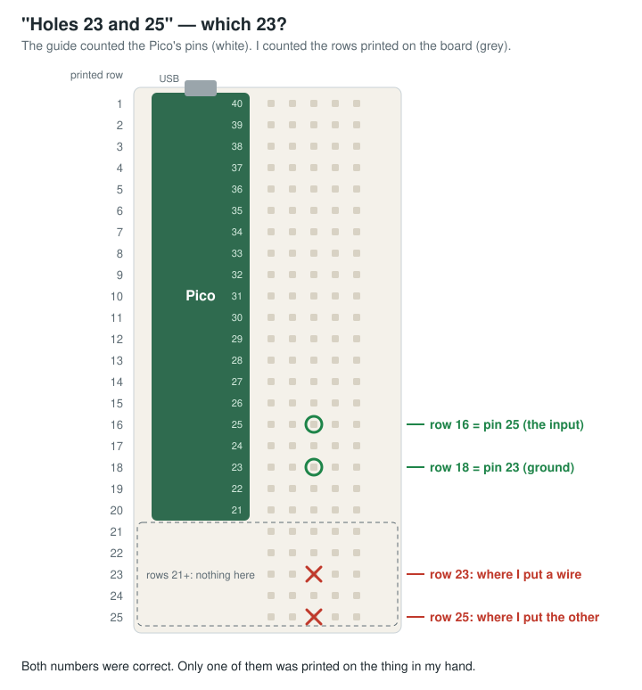

# Count the Printed Rows

*What working with an AI looks like when you're not the expert: my job was to
be the one who checks.*

On my desk there's a breadboard with a Raspberry Pi Pico on it, and the Pico is
a coquí: the tiny Puerto Rican frog that's also the face of Amigo, the local AI
assistant I built for my house. Press its button and it answers in one or two
playful sentences, as a frog who wants to be an astronaut. Recently it grew a
button for each of my sons, an arm that waves when it talks, and an infrared
remote that starts games on the LED strip.

I should be clear about who did what. I teach maths. I am not an electronics
person. An AI assistant wrote the firmware, the desktop code and the
step-by-step wiring guides. It was fast, it was thorough, and it was
confident, including the times it was wrong.

That's the part this piece is about. When you work with an AI on something
you're not an expert in, it's tempting to think your job is to ask good
questions. Mostly it isn't. Your job is to be the one who checks: to hold the
AI's confident description up against the thing actually in front of you, and
to notice when they don't match. In software, tests do a lot of that checking.
On a breadboard, it was me. Every problem below was a confident description
that didn't match the part on the desk. Every fix started with someone looking
at the real thing.

---

## 1. Hole 23 was not row 23

The first wiring guide said to put the button's wires in "holes 23 and 25". I
put them in rows 23 and 25, the numbers printed down the side of the
breadboard. The button was dead.

The guide meant the Pico's *pin* numbers. Pin 23 is a ground and pin 25 is an
input, and with the board's USB plug at the top they sit beside printed rows 18
and 16. Rows 21 and up were past the end of the Pico and connected to nothing.
Both numbers were correct; they were just counting different things, and only
one of them was printed on the thing in my hand.

Every guide now gives the printed row numbers, with the board drawn the way it
actually sits on my desk. The rule I took from it is simple: **give
instructions in the labels the reader can see.** A pin number is a fact about
the chip. A printed row is a fact about the desk.

## 2. The remote that started the wrong game

The kit came with a little infrared remote. The guide used the key codes from
the most common version of that remote, and the first time I pressed OK, which
should ask the coquí a question, it started a game of Freeze Dance.

My remote is a different variant with the arrows on top, and its codes are
different. The fix took two minutes: I pressed all seventeen keys in order while
the board printed each code, and those became the table. Any key the program
doesn't recognise is now logged by number, so the next surprise will explain
itself.

A table from the internet describes *a* remote. Reading the codes off the
device in your hand describes *yours*.

## 3. The big button was a guitar pedal

I had a big chunky button from Micro Center, and the plan for a two-player
buzz race was built around it. When I sent a photo, it turned out to be a latching
guitar footswitch: six pins, press it once and it stays on, press again and it
stays off. That's great for a pedalboard and useless for a reaction-time game,
where the button has to spring back.

Nothing in the plan was wrong except the name I'd given the part. One photo
fixed that faster than any amount of description would have.

## 4. If we can't start right

So we used the small yellow push buttons from the kit, one per son, on jumper
wires. They worked. They were also awful: the buttons' legs are too thin to
grip in a jumper socket, they wobbled loose, and when I bent the legs to make
them hold, the legs started to break.

I said, more or less: *if we can't start right, I don't want to start at all.*
The circuit worked, but a kid will hit a buzzer as hard as he can,
and a button that falls out mid-game is a broken game. So we stopped. The plan
now is proper arcade buttons with quick-disconnect wires, and the reaction game
waits until they arrive.

That was the right call, and it cost nothing but a few days. **A working
circuit isn't a finished one** when the people using it are children.

## 5. The wave that was one twitch

The arm is a small hobby servo that waves gently whenever the coquí starts
talking. The first real wave was one quick twitch.

The firmware moves the arm in small timed steps. But when someone walks past,
the motion sensor triggers a greeting with a sweep of the light strip and a
chirp, and that held the main loop for about 0.6 seconds in the middle of a
wave. When the loop came back, the code dutifully "caught up" on every step it
had missed, all at once: sixteen moves in one instant, which the servo
rendered as a jerk. A late step now *pauses* the wave instead of skipping
ahead.

What made that fix trustworthy was a set of small simulators that run the
exact firmware file, unchanged, against fake pins and a fake clock. They can
hold the loop for 0.6 seconds on purpose and check that the arm still waves
smoothly afterwards. The same trick covers the remote decoder and the light
games. None of them replaced looking at the real arm, but they meant each fix
was checked before it went near the board.

## 6. A stop button for a talking frog

The coquí sometimes talks for too long, so I asked for a way to stop him
mid-sentence. This one took three tries, and the second try taught me the most.

The simple way the desktop plays sound can't be interrupted from another part
of the program. Tested: a five-second sound kept playing for five seconds. So
the second try chopped each answer into one-second slices and checked for a
stop between them. It worked, and it sounded terrible. Each slice cost about a
quarter of a second of silence to start, and the coquí's voice has no pause
long enough to hide that. My verdict was that he didn't sound good: a lot of
pauses and sound gaps.

The test had passed. My ears had not. The third try plays the whole answer
through a lower-level Windows audio call that can be cut off instantly, so the
voice is continuous again and the OK key stops him mid-word. Then one more
note from the listener, "a little fast", and the voice now runs at 0.9 speed.

---

## What the checking looked like

None of the six fixes needed me to know more electronics than the AI. They
needed me to check, in a handful of plain ways.

**Look at the real thing.** A dead button, a remote that started the wrong
game, a "button" that stayed down. Each time, the AI's description was
confident and the part on the desk disagreed, and the part was right.

**Show it, don't describe it.** Two of the six problems dissolved the moment I
sent a photo. A picture is the cheapest test there is, and it's the one an AI
can't argue with.

**Read values off the device.** Key codes, which way the servo sits, which
button is which. A table from the internet describes *a* remote. The one in my
hand is the specification.

**Decide what "done" means yourself.** The flimsy buttons worked. I still said
no, because I know who's going to be pressing them and how hard. The AI can't
know that, and it shouldn't be the one to decide.

**Don't take "it passed" as the last word.** The stop button passed its test
and sounded terrible. A check that runs by itself can only test what someone
thought to write down. My ears tested what mattered.

I don't think any of that is specific to frogs or breadboards. It's what I
already ask of my students: check your answer against what's actually in front
of you, not against what you expected to see. Working with an AI just puts me
on the other side of that. It does the confident first draft quickly. My job
is the part a student learns last and needs most, which is noticing when the
confident answer is wrong.

---

*The coquí is a Raspberry Pi Pico running MicroPython: buttons, a buzzer, an LED
strip, a motion sensor, an SG90 servo and a VS1838B infrared receiver. It
plugs into a Raspberry Pi, which relays it to the desktop, where a Python
program talks to a local language model and a local text-to-speech voice.
Nothing leaves the house. Code private.*
